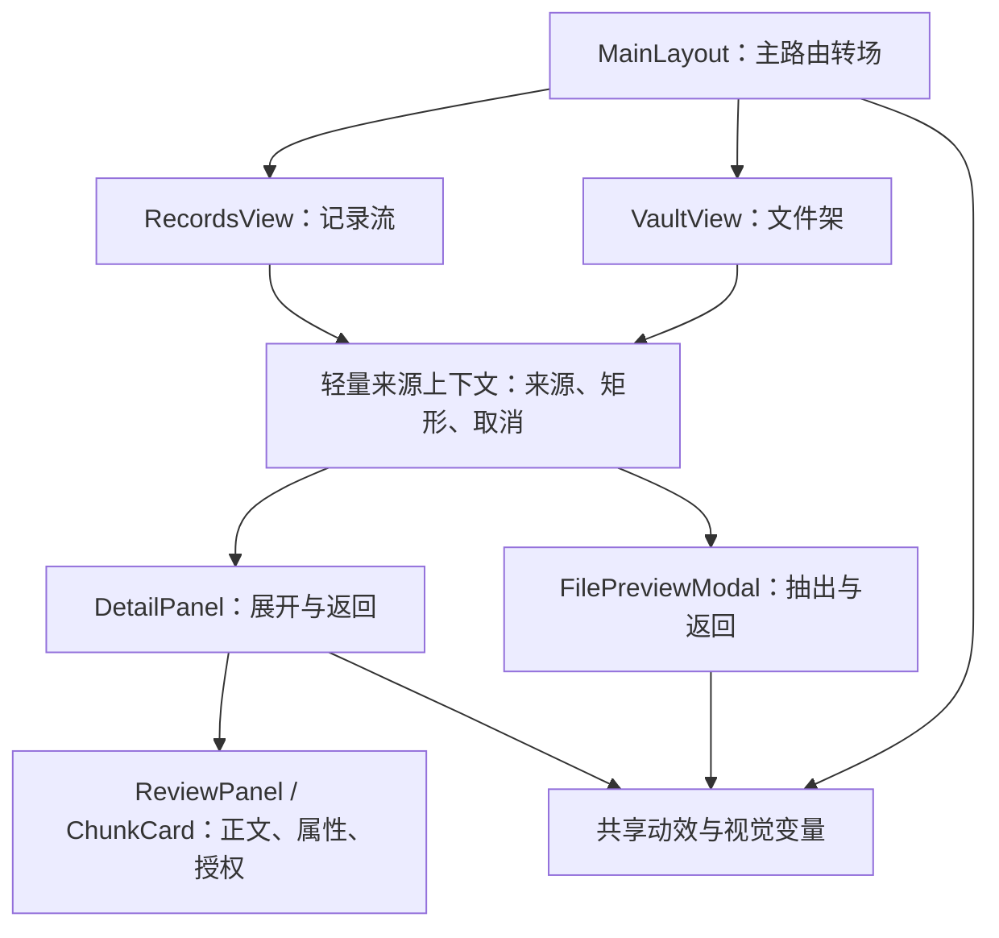
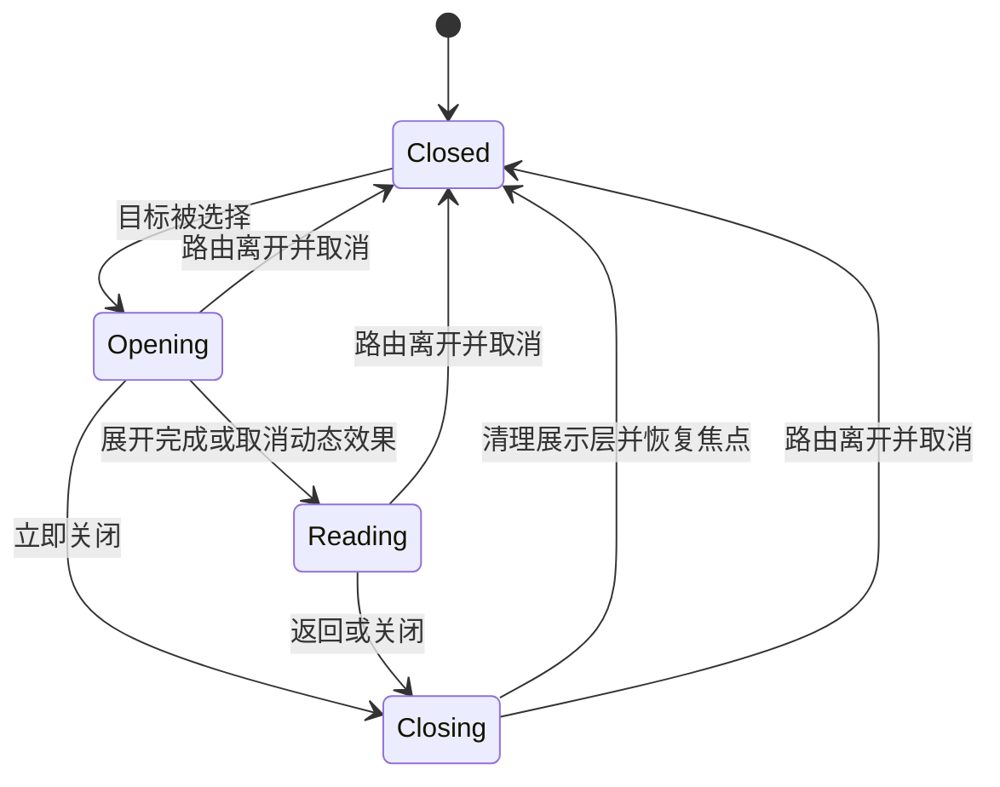
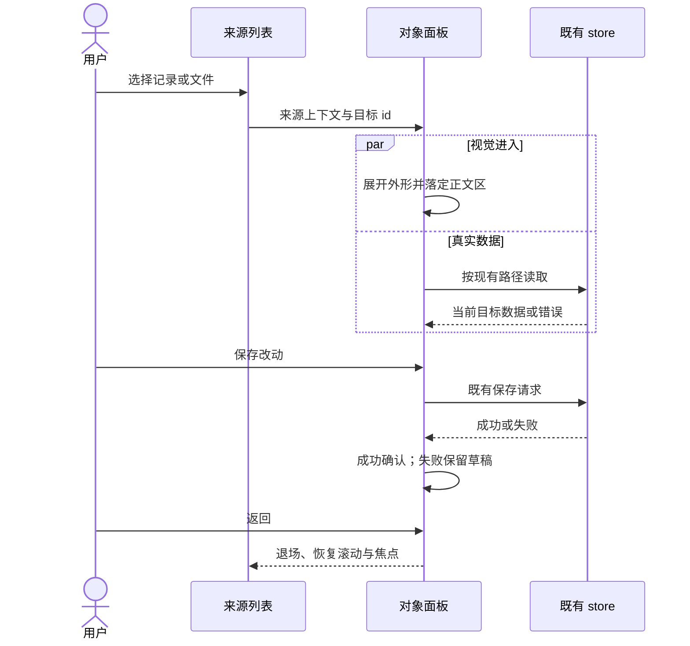

# Mirror：记录、记忆详情与资产库动效设计 - Plan

## Goal Capsule

**Objective：**用户浏览日记、打开记忆和翻阅资料时，能感到页面有清楚的视觉重点，每次操作都有看得清、接得上的变化，回到列表时仍知道自己刚才看到哪里。

**Means：**以时间轴、展开的阅读面和文件架重组三个页面，用有来源、有去向的动效衔接它们，延续当前 P3R 蓝色视觉方向。实现机制见 KTD1–KTD7。

**交付边界：**本次交付设计和执行计划；生产前端尚未实施。用户明确指定后续由 Luna 执行。图版为布局与分镜示意，不是已实现页面。

**Authority：**用户本轮要求及补充回答优先；Requirements 约束产品行为；设计规范与 KTD 约束实现；示意图不覆盖正文中的状态、尺寸与交互规则。代码和旧文档中的历史描述仅作为现状证据。

**完成与发布：**后续执行者完成 U1–U6 和 Verification Contract。实现授权不自动包含发布、合并或部署。

配套图版：[三页布局与动画分镜](../design/mirror-ui-motion-board.svg)。图版的内容是示例，执行以本计划的状态规则为准。

---

## Product Contract

### Summary

记录列表从等尺寸白卡网格变成有日期锚点的记录流；记忆详情从满宽表单变成正文和属性分开的阅读空间；资产库从满宽管理行变成紧凑文件架。动画连接选中对象、详情、保存结果和返回位置。

### Problem Frame

用户喜欢现有页面切换效果，认为其余界面太板正、动效单调。用户已经明确补充：日记界面既有切换太快的问题，也有内容太空、太像一块块表单的问题。

截图中的水面和侧栏已有个性，内容却主要靠白色矩形堆叠。列表的正文层级弱；详情中少量内容横跨整个屏幕；资产行包含许多操作，却没有文件本身的视觉身份。用户进入和退出这些对象时，也缺少位置和形状的连续性。

### Requirements

R1. 设计和实施覆盖记录列表、记录详情及资产库，补齐三者相关的筛选、打开、操作与返回动效。

R2. 保留蓝色、水面、斜切标题和现有大页面转场的设计身份，内容区域增加阅读层级及有意义的疏密变化。

R3. 日记详情的进入过程要能看清展开顺序，正文出现后即可阅读，不为播放完动画阻止操作。

R4. 每次对象打开都保留其来源，关闭时回到对应记录或文件；找不到来源时平稳退场并回到有效的列表焦点。

R5. 类型、情绪、关键词和授权状态要有明确的选择反馈；编辑草稿、保存中、成功和失败在视觉及文案上可区分。

R6. 保持现有仅记录、AI 整理、片段记忆授权和待办授权的业务边界；视觉动作不代替用户确认，也不触发额外 AI 请求。

R7. 资产上传、提取、确认、预览、下载和删除继续使用既有数据与接口；动画只表达真实的返回状态。

R8. 键盘、触屏和系统减少动态效果设置下，所有主要操作均可用；文字和输入控件保持稳定、清楚。

R9. 切换筛选、轮询刷新、连续点击和请求失败时，不出现残留遮罩、旧内容覆盖新内容、丢失输入或重复提交。

### Key Flows

F1. 记录列表 → 选中卡片 → 阅读详情 → 调整片段信息或授权 → 保存结果 → 返回原记录。Covers R3–R6, R9。

F2. 记录入口 → 已有写作面板 → 保存 → 既有记录状态出现在记录流；面板保留当前输入限制与保存选项。Covers R1, R6, R9。

F3. 文件架 → 选中文件 → 展开预览 → 关闭 → 回到来源文件。Covers R4, R7–R9。

F4. 投放文件 → 填写上传信息 → 上传成功 → pending / extracted → 用户确认 → confirmed；失败停在可继续操作的位置。Covers R5, R7, R9。

### Scope Boundaries

此次视觉重组以三个页面为主。写作面板、每日总结、日历和右侧概览只调整与这些页面连接的入口、返回、焦点及视觉一致性，不重做其完整业务。

以下为设计者为控制实施范围作出的建议：不恢复 P3R 人物立绘，不增加页面音效、WebGL 水面、无规则随机卡片乱摆、拖拽排序、视差滚动或新的仪表盘。现有水面图和少量抽象反射足以支撑方向。用户后续明确授权的确定性交替错位、分组轨道偏移与稳定变体轮廓属于当前设计，不算随机摆放。

不新增缩略图服务、音频播放器或 AI 配图。当前资产数据没有封面地址；卡片使用类型图形，真实内容仍由主动预览入口加载。

### Acceptance Examples

AE1. 在列表滚动到中部打开一条记录，正文展开后修改一个情绪并保存；返回后列表停留在原位置，来源记录获得焦点。Covers F1 / R4–R5。

AE2. 连续打开记录 A、立即关闭、再打开 B，最后只展示 B；A 的迟到响应与动画回调均不能重新打开或覆盖 B。Covers R9。

AE3. 勾选某片段的记忆授权后编辑该片段关键词，未保存的勾选保持不变；保存失败仍显示原草稿和未保存状态。Covers R5–R6, R9。

AE4. 上传成功仅显示“已上传 / 整理中”；只有真实确认成功才显示“已可检索”，不能用收纳动画暗示已授权。Covers F4 / R7。

AE5. 文件编辑保存失败，原编辑区域和输入保留；删除撤销窗里的卡片能恢复。离开资产页继续遵守既有延迟删除处理规则。Covers R7, R9。

AE6. 开启减少动态效果后，使用键盘打开详情、移动焦点、关闭并继续浏览，不依赖动画结束事件释放界面。Covers R8–R9。

---

## Design Specification

### 视觉方向：水下的记忆，清楚的阅读面

整个产品共享同一片深蓝背景。不同任务有不同构图：记录以时间组织，详情以阅读组织，资产以文件组织。斜切集中在标题、选中标记与面板边角；正文、表单和长段落保持水平。

沿用现有六色：深海 `#06123f`、海蓝 `#0737bb`、亮蓝 `#1762ff`、青色 `#50edfa`、强调粉 `#ee246a`、阅读纸面 `#f8fbff`。正文配色继续使用现有 text 变量。粉色用于待处理提示等短小重点，不铺成大片背景。

英文标题及日期使用已有 Barlow Condensed，中文使用已有系统无衬线字体。桌面英文标题 56–80px，页面中文名 24–28px，记录标题 19–22px，正文 16–17px、行高 1.8–1.95，辅助信息 12–13px。手机正文不低于 16px。英文展示字不挤压中文标题。

内容区最大宽度建议 1440px，随可用空间伸缩。阅读正文最大约 38–42 个汉字一行。水面主要露在边缘和空隙；长文本后方使用稳定、充分遮蔽纹理的底色。

### A. 记录列表：日期锚点与连续记录流

桌面使用“日期轨道 72px + 主记录流 + 概览 256px”。右侧概览仅在现有宽屏条件下常驻；主记录流空间不足 600px 时概览收回现有抽屉入口。不要固定三栏后把正文挤窄。

页面上部的写作入口压到约 112px 高，去掉大幅横向空白。当前日期与正在查看的历史日期分开标明：写作入口仍指向今天，日期轨道表达筛选日，不把两者混写。

整个当前可见列表只有第一条记录成为更大、更亮的主卡；其余记录按稳定序号使用确定性的左右交错、宽度与切角变体，并以青色轨道、粉/青偏移阴影形成文件夹页叠层。日期组轨道按奇偶组错开并有斜线连接。主次只表示阅读顺序，不暗示 AI 评定的重要性。单条、短文本不强行撑高；文字和表单始终正向、完整可读。保持真实时间倒序及 DOM 阅读顺序，不使用随机旋转或无规则乱摆。

情绪圆点、类型与状态靠近标题，但正文比元数据醒目。记录数量和摘要只取既有数据，不增加 AI 标题、热度或虚构统计。

右侧概览整合为一个深色侧区，内部用分隔线容纳今天、每日总结、最近情绪和待办。保留现有内容及入口，减少四个白卡抢夺注意力。

手机改为单列日期标记与记录流；焦点/点击标记可见。hover 只用于增强，不承载编辑、预览或保存的唯一入口。

### B. 记忆详情：一段记录展开成阅读空间

进入后保留外围深蓝舞台，内部布局为“日期与片段导航 + 正文阅读面 + 属性栏”。桌面正文约占内部可用宽度 64%，属性约 32%，其余为间距；窄屏将属性移到正文之后。

记录日期来自该记录 created_at，使用项目现有时间工具格式化。标题使用既有片段标题；仅记录、处理中或无标题时，展示正文与对应状态，不能伪造分类标题。

原文与当前片段有清楚区别：原文可折叠但始终可找到；当前片段正文占主阅读面；AI 摘要在正文之后。片段导航显示真实数量，当前项有青色标记。多片段垂直浏览时，点击导航定位到对应片段；用锚点和滚动定位维持内容，不为切换片段销毁输入中的组件。

属性栏先展示已选类型、情绪、关键词。需要编辑时展开选择面板；reviewing 记录首次进入时直接展开审核必要的控件。未分类字段有明确占位，仍可直接调整。长选项组可换行，不能靠横向溢出承载。

记忆授权与待办授权放在对应片段下方的清楚操作区，视觉上保持独立。原文只读、仅记录可编辑、不同状态可操作范围依现有逻辑；不把全部 done 文本统一降低透明度。

页顶使用清楚的“返回”和现有主操作文案；存在改动时就地显示“未保存”。保存成功在操作附近确认，不用整页庆祝动画打断阅读。

### C. 资产库：可抽取的文件架

顶部将上传入口压成约 112px 的投放槽，配额移成小型状态行；低信息/待确认入口保持在筛选前。拖入文件时展开投放槽，离开拖入区域后收回，避免计数器抖动造成闪烁。

文件区由可用宽度决定 1 / 2 / 3 列，建议卡片最小宽度 260px、最大三列。卡片为稳定文件封套：左上类型图形，主体标题及最多两行既有描述，下方放类型、大小、日期与真实处理状态。状态和操作始终可见。

文档用折角与文本线条，图片用取景框图形，音频用静态声纹图形；这些只表达类型。卡片不自动请求预览文件，音频图形不暗示已存在可播放预览。文件名过长可换行，不能扩大布局。

预览从来源文件的位置展开，文件名延续到预览标题，关闭时收回。现有编辑/补确认仍在卡片内部展开，不引入第二套保存表单。编辑区展开时仅撑开该网格行，后续条目平稳移动。

### Motion Specification

以下时间是本方案的设计起点，不是 P3R 的实测参数。主页面转场、对象展开、控件反馈使用不同幅度，但共享“快速响应、稍慢落定”的节奏。跨页面大转场仅由路由拥有；本地筛选与打开详情不重播整屏遮罩。

| 编号 | 触发与起点 | 分镜及终点 | 建议时长 | 可打断与状态要求 |
| --- | --- | --- | --- | --- |
| M1 | 主路由导航 | 保留现有双斜切与目的地文字；进入视图标题接续出现 | 现有约 600ms | 路由完成后不再叠加一轮全页入场；快速导航以最后一次为准 |
| M2 | 记录页首屏就绪 | 青粉斜带扫过封面；日期轨道由上向下绘制；主卡先斜切舒展，后续卡片按稳定序号从左右/下方分层进入，概览最后落定 | 约 1.4–1.6s；每步保留约 120–180ms 的可辨间隔 | 仅首次可见区域有级联；轮询、追加和滚动不重播；动画期间仍可交互 |
| M3 | 点击记录打开详情 | 0–100ms 青色选中标记响应；60–360ms 来源外形以斜切轮廓展开为阅读面；220–540ms 日期、正文和属性依次落定，文字保持正向 | 540–620ms | 复用来源外形与阅读面轮廓；正文出现即可阅读；请求未完成则在目标阅读面显示加载态，失败显示重试与返回 |
| M4 | 关闭详情或文件预览 | 正文及属性先退，外形收回仍可见的来源；焦点回到来源 | 记录 360ms / 文件 300ms | 先缓存展示数据再退场；无有效来源时 140–180ms 淡出，不滚动寻找来源 |
| M5 | 切换筛选 | 青色选中底片移动；旧条目按变体从不同方向斜切退场、保留条目沿网格补位、新条目按主次轮廓进入 | 360–420ms | 稳定 key；快速切换取消旧动画，最后一次选择生效；不移动整个页面 |
| M6 | 属性展开 / 标签选中 | 面板高度展开并露出选项；选中底片与圆点短距离变化 | 展开 240ms / 选择 160ms | 输入、焦点稳定；面板操作叫“收起”，不撤销已自动保存的标签；“取消”仅用于未提交草稿 |
| M7 | 保存或授权更新 | 点击即显示真实保存中；成功后操作区一次青色短线扫过并显示成功；失败保留编辑区 | 成功反馈 220ms | 未成功前不显示“已保存 / 已可检索”；不为动画延迟请求或增加最短等待 |
| M8 | 资产预览 | 文件封套先抬起并沿切角展开，预览标题承接文件名，真实内容进入阅读面；返回沿原位收回 | 440–480ms | 文件请求与动画并行；慢请求不冻结；不支持的格式使用现有下载路径 |
| M9 | 拖入 / 上传 / 入架 | 投放槽以高低和切角展开；上传表单从侧上方入场；真实上传成功后文件封套分层错位入架 | 投放槽约 360ms，表单约 480ms，入架约 480ms | 按真实流程独立触发；不显示伪百分比；pending、extracted、confirmed 各自表达，不能串成假成功 |
| M10 | 写作入口与保存回流 | 写作按钮的青色标记延续到已有写作面板；保存成功后目标记录短暂高亮 | 进入约 420ms / 回流 300ms | 复用现有写作工作区；目标被筛选隐藏时用现有通知说明，不擅改筛选 |
| M11 | 删除及撤销 | 确认删除后条目退出，相邻条目补位；撤销后原条目返回 | 退出 200ms / 补位 240ms | 动画不改变既有五秒撤销和离页处理行为 |

缓动建议：面板展开使用 `cubic-bezier(.16,1,.3,1)`，进退移位使用 `cubic-bezier(.22,.61,.36,1)`。常见位移 6–18px，hover 最多 2px；仅对象展开跨越大距离。普通正文不做弹跳、倾斜或水波扭曲。

水面气氛使用独立装饰层的缓慢变换，可选 18–24 秒低幅循环；页面不可见或打开密集阅读/编辑面时暂停。该循环优先级低于交互动效，不影响页面可用性。若性能不足，保留静态水面即可，主衔接仍须完成。

---

## Planning Contract

### Context and Research

目标基线是含 `p3r.css`、`PageMasthead.vue` 和双斜切转场的前端工作副本，提交见 frontmatter。该副本当前为 detached HEAD。不能把旁边缺少这些文件的旧主副本当作本方案的实现基线。当前未提交的 `src/stores/chat.js` 与 `src/views/ChatView.vue` 属于其他工作，本方案不覆盖它们。

现状依据：

- `src/components/templates/MainLayout.vue`：全局水面、路由转场、route-wipe、全局详情挂载点。
- `src/views/RecordsView.vue`：日期分组、状态筛选、双列网格、概览抽屉、处理轮询。
- `src/components/molecules/RecordCard.vue`：文件后部的 `animation:none` 覆盖了前部 `cardIn`；当前传入的级联延迟并未生效。
- `src/components/organisms/DetailPanel.vue`：详情是 Teleport 层，不是新路由；独立浅色底覆盖水面，当前 `slide` 转场约 300ms。
- `src/components/organisms/ReviewPanel.vue`、`ChunkCard.vue`：原文、片段、属性及记忆/待办选择；属性有自动保存，不能误改成整页统一保存。
- `src/views/VaultView.vue`、`AssetCard.vue`：上传、补确认、原地编辑、删除与撤销；文件保存发出事件后即收起编辑，需要配合失败反馈调整。
- `src/stores/vault.js`、`FilePreviewModal.vue`：资产数据没有封面地址；预览按需取文件，现有音频预览能力有限。
- `docs/ui-redesign.md`：历史方向与人物移除记录，保留现有素材归属；不要误读开头较早的人物方案。

P3R 的水下氛围和反射主题来自已查阅的[开发者访谈](https://www.famitsu.com/news/202311/29325647.html)，用于统一主题；本方案的构图、动作和时长均为针对 Mirror 的设计。列表插入/移位采用 Vue 现有内置能力，依据 [TransitionGroup 文档](https://vuejs.org/guide/built-ins/transition-group.html)；跨容器对象动作可用浏览器原生 [Web Animations API](https://developer.mozilla.org/en-US/docs/Web/API/Web_Animations_API/Using_the_Web_Animations_API)。

### Key Technical Decisions

KTD1. **沿用 Vue Transition / TransitionGroup 和 CSS，跨容器动作使用少量原生动画。** 不引入 GSAP、重型 UI 套件或 View Transitions API 作为唯一实现。已有工程足以承载本次范围，减少执行环境依赖。Governs R1–R4, R8。

KTD2. **共享动效 token 和一份轻量来源上下文。** 建议新增 `src/composables/useObjectTransition.js`，只管理来源 id、来源 DOM 标识、点击时矩形、当前动画句柄与取消；业务状态仍属于既有 store。结束时重新测量可见来源，不盲用旧坐标。Governs R4, R9。

KTD3. **对象动作使用临时展示层，保留真实内容组件。** 展示层只包含阅读面的形状和短标题，不复制输入、文件媒体、控件 id 或完整交互 DOM。目标布局先计算终点，再由外形连接；字形不随容器缩放拉伸。无来源入口直接在目的地展开。Governs R3–R4, R8。

KTD4. **路由动效和对象动效各有唯一所有者。** `MainLayout.vue` 继续拥有 M1；DetailPanel 和 FilePreviewModal 拥有对象的进入/退出。仅详情关闭动画结束后再清理展示数据；真实业务选中 id 可按现有约定清理，但不能因此提前卸载整个退场面。路由离开优先取消对象动画，不能被旧结束回调重新打开。Governs R1, R4, R9。

KTD5. **异步结果与对象 id / 操作身份匹配。** 详情与文件预览只接受当前目标的响应；记忆和待办选择只在切换记录或相应授权真实更新时同步，不能被片段元数据更新覆盖。资产保存失败时编辑状态与草稿继续存在；成功才收起。片段自动保存期间禁用该片段的变更控件，防止当前 saving 分支丢弃后续点击；失败保留 dirty 标记并提供就地重试，正文失焦失败不清除已改状态。对照当前接口定位最小负责层，不重写全部 store。Governs R5–R7, R9。

KTD6. **滚动、焦点和减少动态效果与动画一并实现。** 保存列表滚动容器的位置，而非仅处理 window。复用 `src/composables/useDialogFocus.js` 的基础能力，但补齐弹层替换时的焦点交接：Summary / 概览抽屉转到 Write / Detail 时，退出层不抢回焦点，最终返回可见的持久入口。只有最上层拥有焦点约束、Escape 和滚动锁，路由离开不把焦点送回旧页面。

当前没有共享的未保存关闭提示。本轮在可能丢弃写作、文件编辑、原文编辑或待提交授权的关闭、切换目标、离页入口，加入最小“继续编辑 / 放弃未保存修改”确认；继续编辑不播放退场、不发保存请求，放弃只清理未提交部分，不回滚已经自动保存的标签。退出不依赖某一条 CSS 事件必然触发。减少动态效果取消大位移、裁剪与循环，反馈可用不超过 120ms 的淡入或直接变更。Governs R4–R5, R8–R9。

KTD7. **详情壳与文件资源拥有明确生命周期。** 选择 id 后即可挂载详情壳，不再要求缓存已有 record 才显示；内部有加载、成功、失败、重试和返回状态。文件预览按目标 id 切换或重挂载，旧请求作废后不能创建 Blob URL。正常退场保留正在显示的媒体至退场完成再释放；强制路由离开立即清理，迟到响应不能恢复媒体或面板。Governs R3–R4, R7, R9。

### High-Level Technical Design

组件与职责：

对象显示生命周期：

请求与动画并行，成功由业务结果决定：

### Assumptions and Deferred Details

本方案的版式、时长、颜色分配和实现机制均为设计者建议，尚未经过用户观看实际动效后的视觉验收。用户明确确认的偏好是更多动画衔接、减少板正表单感，以及同时改善太快与太空。

精确的来源外形插值、窄屏时间和首屏级联数量，由执行时的真实布局与设备检查微调；不可据此省掉 M3/M4 的前后连续性。大路由转场保持当前风格，日记对象展开刻意比当前 300ms 慢。

`src/composables/useDialogFocus.js` 已有焦点约束和触发源恢复，但缺少 KTD6 的弹层交接与草稿关闭保护；执行时扩展这两个实际缺口，不另建通用弹层框架。

### Risks and Sequencing

最先确认来源上下文、Teleport 生命周期与取消动作，再铺三个页面，最后统一完整路径。若只改 CSS，详情数据会在返回动画前清空，无法获得可靠的连续体验。

全屏 clip-path 和大量动态布局可能影响手机流畅度。优先使用 transform / opacity，只在独立视觉层裁剪；不逐帧改变整页宽高，不把轮询刷新接成整屏重播。

---

## Implementation Units

### U1. 统一视觉变量与对象动效基础

**Goal：**为三个页面建立一致的动效节奏、可取消的对象展开和减少动态效果路径。

**Requirements：**R2–R4, R8–R9；M1、KTD1–KTD4、KTD6。

**Dependencies：**无。

**Files：**修改 `src/assets/styles/variables.css`、`transitions.css`、`p3r.css` 和 `src/components/templates/MainLayout.vue`；新增 `src/composables/useObjectTransition.js`；验证载体拟新增在忽略目录 `.verify/mirror-motion-smoke.cjs`。

**Approach：**整理被本轮组件使用的重复覆盖规则，统一时长和缓动；让路由层与对象层只各自播放一次。实现来源获取、取消、清理及无来源退化路径。保持现有导航及水面素材。

**Test Scenarios：**

1. 连续切换三个主页面，只有最后一页保持显示，临时层不拦截点击。
2. 来源在列表、来源不在视口、直接从侧栏打开三种情况均能正常进入和退出。
3. 动画中触发路由离开或减少动态效果，遮罩和临时样式均清理。

**Verification：**在不改业务请求的情况下验证以上浏览器路径，检查正常与减少动态效果两套结果。

### U2. 记录流构图与局部切换

**Goal：**记录列表有日期节奏和清楚的正文重点，筛选时保持上下文。

**Requirements：**R1–R2, R8–R9；Design A、M2、M5；KTD1。

**Dependencies：**U1。

**Files：**修改 `src/views/RecordsView.vue`、`src/components/molecules/RecordCard.vue`、`src/components/organisms/RecordsSidebar.vue`；验证载体 `.verify/mirror-motion-smoke.cjs`。

**Approach：**将双列同权白卡改为日期分组记录流；概览采用共享深色侧区。记录点击带出有效来源信息。使用稳定 id 处理列表移位，移除互相覆盖的卡片动画定义，首屏与刷新有不同的触发条件。

**Test Scenarios：**

1. 同一天一条、同一天十条、跨三天记录，日期归属与时间顺序不变。
2. 快速切换“全部 / 仅记录 / 待审核 / 已入库”，最终选中项与结果一致，没有全页闪白。
3. processing 轮询变为 reviewing，只有相关条目变化，已经读到的记录不重播入场。
4. 查看历史日时，写作入口日期和历史日期各自表达正确。

**Verification：**桌面主记录列不被右栏挤窄，手机阅读顺序一致；空态、加载态、失败重试仍有明确入口。

### U3. 记忆详情布局与完整进退

**Goal：**日记从选中位置展开，读完后回到原位置，正文有舒服的阅读尺度。

**Requirements：**R1–R4, R8–R9；F1、AE1–AE2、Design B、M3–M4；KTD2–KTD4、KTD6–KTD7。

**Dependencies：**U1、U2。

**Files：**修改 `src/components/organisms/DetailPanel.vue`、`ReviewPanel.vue`、`ChunkCard.vue`；必要时仅扩展 `src/stores/ui.js` 的来源入口；验证载体 `.verify/mirror-motion-smoke.cjs`。

**Approach：**保留外围深蓝并重组正文/属性区域；通过展示快照支持退场，避免 selected id 清空时详情立即消失。加入 KTD7 的详情壳，覆盖无缓存记录的加载与失败。片段导航定位而不销毁输入区。按 KTD5 校验异步目标，继续沿用原来的记录读取及状态分支。

**Test Scenarios：**

1. Covers AE1。记录流中部打开、滚动详情、返回，原列表位置及焦点恢复。
2. Covers AE2。模拟 A 请求比 B 慢，最终页面不会回到 A。
3. 从日历、概览待办、无来源位置打开详情，均可关闭；不滚动去寻找不存在的来源。
4. 单片段、多片段和超长正文下，正文不横跨整个屏幕，片段导航不覆盖焦点。
5. 无缓存来源记录加载失败时，面板可重试、可返回，不显示旧记录；加载中关闭不会被迟到响应重新打开。

**Verification：**本地录屏能看清 M3/M4 的展开与收回；打开约 540ms、关闭约 360ms，且正文无需等全部装饰结束才能使用。

### U4. 属性调整与真实保存反馈

**Goal：**标签、草稿和独立授权操作有连贯且诚实的反馈。

**Requirements：**R5–R6, R8–R9；AE3、M6–M7；KTD5–KTD6。

**Dependencies：**U3。

**Files：**修改 `src/components/organisms/ReviewPanel.vue`、`ChunkCard.vue`、`DetailPanel.vue`；验证载体 `.verify/mirror-motion-smoke.cjs`。

**Approach：**加入属性展开及选中变化，保持现有自动保存与整页授权保存的区别；记录级、片段级草稿按对象 id 保持稳定。只修正本路径中会覆盖未保存选择的同步时机，不扩展后端规则。

**Test Scenarios：**

1. Covers AE3。先改记忆授权再编辑关键词，待保存的选择仍保留。
2. 标签自动保存成功/失败分别表达结果；整页授权仍通过现有按钮提交，不因展开或关闭属性面板而提交。
3. 同一片段的记忆授权和待办授权可以独立选择；仅记录状态不会因页面动效触发 AI。
4. 保存中重复点击不增加请求；保存失败保持输入和未保存状态，能再次提交。
5. 连续尝试选择类型 A、B 时，控件在保存 A 期间不可变更；恢复后选择 B 能真实保存。文本保存失败后点击重试，仍提交原草稿。
6. 有待提交授权时点击返回、选择其他记录或导航离页，“继续编辑”保留选择与焦点；“放弃”不回滚此前已经成功自动保存的标签。

**Verification：**用请求记录核对改动前后的接口及请求数量，视觉反馈与真实结果一致。

### U5. 资产文件架与抽取预览

**Goal：**资产以文件身份呈现，上传、编辑、预览与撤销都能接回原对象。

**Requirements：**R1–R2, R4–R5, R7–R9；F3–F4、AE4–AE5、Design C、M4–M5、M8–M9、M11；KTD1–KTD7。

**Dependencies：**U1；复用 U3 已验证的对象进退模式。

**Files：**修改 `src/views/VaultView.vue`、`src/components/molecules/AssetCard.vue`、`src/components/organisms/FilePreviewModal.vue`、必要的 `src/components/atoms/FileTypeIcon.vue`；若当前保存结果无法返回到卡片，仅在既有父子边界补齐结果；验证载体 `.verify/mirror-motion-smoke.cjs`。

**Approach：**实现文件架及类型封套；预览延续来源文件名及形状，关闭归位；内嵌编辑保留草稿直至真实成功。上传槽分步展开，文件状态仍来自原 store。真实预览仅在用户主动打开时请求。

**Test Scenarios：**

1. Covers AE4。上传、提取和确认的各个阶段使用正确状态，不提前显示“已可检索”。
2. Covers AE5。编辑保存失败不收起草稿；删除后撤销恢复相应文件；离页处理遵循原规则。
3. 图片无描述、过大文件、失败提取仍走既有校验与补确认路径。
4. PDF、图片、文本与不支持内嵌的格式分别验证预览和下载；长文件名不撑破卡片。
5. 切换筛选、打开关闭预览均不批量请求文件内容；预览失败仍可退出，来源焦点恢复。
6. 慢预览 A 未返回就关闭并打开 B，最终只显示 B；A 不产生遗留对象 URL，正常退场的 B 媒体不提前变空。

**Verification：**1 / 2 / 3 列布局无横向溢出；现有删除确认、五秒撤销、上传限制和配额全部有效。

### U6. 写作回流、移动端与整条路径验收

**Goal：**三个页面在连续操作中形成同一套体验，并能交付可回看的证据。

**Requirements：**R1–R9；F2、AE6、M10；KTD6。

**Dependencies：**U2–U5。

**Files：**按需调整 `src/components/organisms/WriteModal.vue`、`SummarySheet.vue`、`src/composables/useDialogFocus.js` 及其入口，更新 `docs/ui-redesign.md` 的本轮设计与验证记录；验证载体 `.verify/mirror-motion-smoke.cjs`，证据目录拟为 `.verify/mirror-motion/`。

**Approach：**连接现有写作工作区与记录流，只统一入口和回流；每日总结内部布局沿用现状。整理本轮新增的覆盖规则及无用展示层，不改 unrelated chat 文件。

**Test Scenarios：**

1. 完成 F1、F2、F3、F4 全流程，并覆盖处理中、未分类、仅记录、审核、已入库、失败、空列表。
2. Covers AE6。键盘和减少动态效果完成相同路径；触屏可找到所有操作。
3. 慢请求、失败请求及连续打开/关闭情况下没有遮罩残留、焦点丢失或输入清空。
4. 既有每日总结、日历打开记录、写作快捷键、聊天等受共享样式影响的入口仍正常。
5. 从每日总结进入写作/来源记录、从概览抽屉进入详情，全程只有当前层约束键盘；最终关闭回到可见页面入口。
6. 写作或文件输入尚未提交时，从关闭、切换筛选、离页等会销毁该输入的路径退出，可继续编辑或明确放弃，输入不被动画回调静默清空。

**Verification：**完成下面的全局验证，不以静态截图代替动效验收。

---

## Verification Contract

工程当前只有 `dev`、`build` 和 `preview` 脚本，没有现成单元测试套件。本轮以实际浏览器交互、构建和窄范围回归为主，不为颜色、间距和动画时长编写镜像单元测试。行为验证可复用本机已有浏览器驱动；`.verify/` 下脚本及样例数据为本地验证资产，不注入生产源码。

执行时必须通过 `npm run build` 和改动差异检查。每个 U-ID 的浏览器场景是验收要求，拟定验证文件路径不是声称这些脚本已存在。

1. 布局检查使用 375、768、1280、1440、1920px 宽；记录来源、属性面板、文件编辑和预览均无横向溢出。
2. 动态验证至少记录三段：记录筛选/打开/返回；片段属性/授权保存成功及失败；文件上传/确认/预览/返回/删除撤销。录屏需包括完整动作和最终稳定状态。
3. 正常与减少动态效果分别验收；无需等待动画的取消回调也能关闭。
4. 请求检查覆盖仅记录不调用 AI、打开文件架不批量取预览、失败提交不假报成功、重复点击不增加请求。
5. 数据使用能重现业务状态的现有后端或明确标注的本地样例；若只能使用样例，交付中明确区分已验证的前端路径与尚未验证的真实后端流程。
6. 在正常滚动和连续操作中观察无持续卡顿；性能录制中不能出现整页每帧重排。不能为了维持装饰循环牺牲输入与滚动。
7. 验证 shared CSS 未破坏日历、每日总结、写作、聊天及设置基本入口；无需重做这些页面。

---

## Definition of Done

- U1–U6 对应的界面和场景全部有可复看的结果；遗漏项在交付中明确列出，不能当作已完成。
- 三个页面采用 Design A–C 的明确构图，能直接看出其任务差异。
- M1–M11 已按相应触发实现，核心对象进退能连续播放，轮询不会重播整页。
- 授权、上传、预览、保存与删除仍满足 R5–R9；出现错误时保留有效输入和恢复入口。
- 通过 Verification Contract；最终交付包含截图、录屏位置和后端验证限制。
- 清理本轮放弃方案的代码、失效 CSS 与临时展示层；不覆盖其他工作的未提交改动。
- 用户完成实际视觉复核；发布或部署另行遵循后续明确授权。
